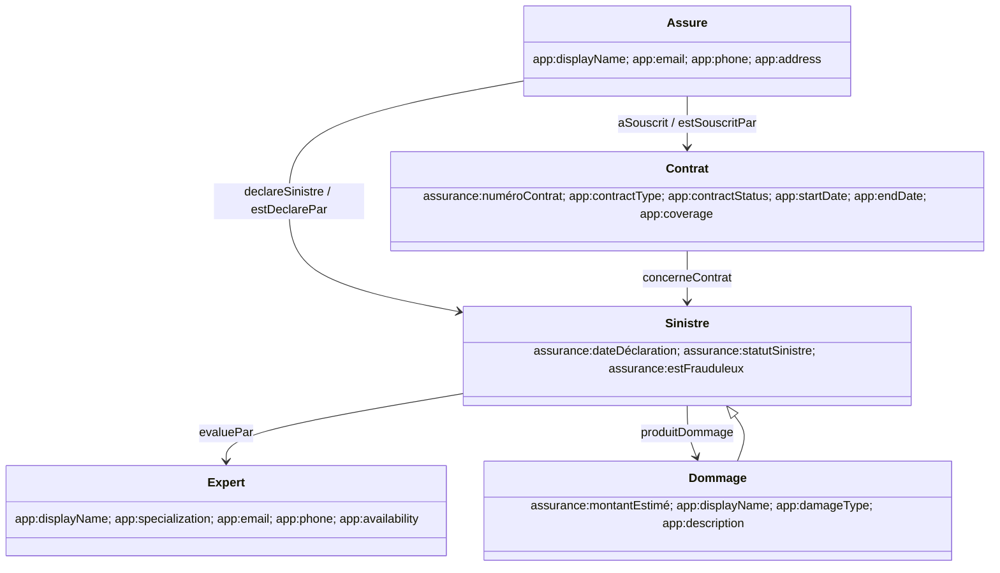

# Phase 5 — Five integrated insurance CRUD modules

## Overview

This phase keeps the existing React/Vite frontend, Express API, session authentication, and Fuseki dataset. It preserves the Phase 2 claim API and adds four managed RDF resource APIs. SQLite remains reserved for authentication. All RDF writes use the backend's private Fuseki writer and the existing `CLAIMS_MUTATIONS_ENABLED` gate; the original ontology file and its named individuals remain protected.

## Team allocation

| Module | Student |
| --- | --- |
| Gestion des Sinistres | Youssef Dhib |
| Gestion des Contrats | Med Hbib Dhaoudi |
| Gestion des Assurés | Med Oussema Meddeb |
| Gestion des Experts | Abderrahmen Jelassi |
| Gestion des Dommages | Aziz Logtari |

## Ontology mapping

The source `ontology/assurance.owl` declares 20 classes, five named individuals, seven object properties, and five data properties. The ontology namespace is `http://www.example.org/assurance#`. The source file was not edited.

| Module | OWL class | Native ontology properties used | Application-vocabulary properties |
| --- | --- | --- | --- |
| Assuré | `a:Assuré` | `a:aSouscrit`, `a:déclareSinistre` (and inverses) | `app:displayName`, `app:email`, `app:phone`, `app:address` |
| Contrat | `a:Contrat` | `a:numéroContrat`, `a:estSouscritPar` / `a:aSouscrit`, `a:concerneContrat` | `app:displayName`, `app:contractType`, `app:contractStatus`, `app:startDate`, `app:endDate`, `app:coverage` |
| Sinistre | `a:Sinistre` | `a:dateDéclaration`, `a:statutSinistre`, `a:estFrauduleux`, `a:concerneContrat`, `a:estDéclaréPar` / `a:déclareSinistre`, `a:évaluéPar`, `a:produitDommage` | Existing application metadata graph holds revisions and deletion markers; generated legacy damage nodes use `app:owner` |
| Expert | `a:Expert` | `a:évaluéPar` from a sinistre | `app:displayName`, `app:specialization`, `app:email`, `app:phone`, `app:availability` |
| Dommage | `a:Dommage` | `a:montantEstimé` (`xsd:decimal`), `a:produitDommage` from a sinistre | `app:displayName`, `app:damageType`, `app:description` |

`app:` expands to `urn:assurance:application:`. These application predicates supply fields absent from the inspected ontology without asserting them as ontology properties. Identifiers use the existing safe IRI convention under the assurance namespace. The named graph `<urn:assurance:application:metadata>` stores `app:revision` and `app:deleted`, matching the claims revision/tombstone mechanism. A revision identifies an application-managed resource; resources without one are read-only.

The ontology declares `Dommage` as a subclass of `Sinistre`. The CRUD API reads explicit `a:Dommage` assertions and does not add or alter the ontology's class hierarchy. The graph has no native insured name/contact properties, expert profile properties, contract type/status/period/coverage properties, or damage description/type properties; the application vocabulary mappings above are therefore intentional.

OWL requires each contract to have exactly one insured and each claim to concern at least one contract. The API UI selects one insured per contract and one contract per claim. No OWL cardinality is declared for the other relationships. The diagram summarizes the actual class hierarchy and properties used by the application; it does not add ontology declarations.

## API catalogue

Every route is under `/api`, requires an authenticated session, and returns the existing `{ success, data }` / `{ success, error }` envelope. List routes accept `page`, `pageSize` (maximum 100), `search`, `filter`, `sort`, and `direction`. `sort` is allowlisted; clients cannot submit SPARQL. Write routes require the existing CSRF and Origin checks, an `ADMIN` or `AGENT` session, and the server-side mutation gate. Updates require a `revision` in the JSON body; deletes require `If-Match`.

| Module | List | Options | Detail | Create | Update | Delete |
| --- | --- | --- | --- | --- | --- | --- |
| Sinistres | `GET /api/claims` | `GET /api/claims/options` | `GET /api/claims/:id` | `POST /api/claims` | `PATCH /api/claims/:id` | `DELETE /api/claims/:id` |
| Contrats | `GET /api/contracts` | `GET /api/contracts/options` | `GET /api/contracts/:id` | `POST /api/contracts` | `PATCH /api/contracts/:id` | `DELETE /api/contracts/:id` |
| Assurés | `GET /api/insured` | `GET /api/insured/options` | `GET /api/insured/:id` | `POST /api/insured` | `PATCH /api/insured/:id` | `DELETE /api/insured/:id` |
| Experts | `GET /api/experts` | `GET /api/experts/options` | `GET /api/experts/:id` | `POST /api/experts` | `PATCH /api/experts/:id` | `DELETE /api/experts/:id` |
| Dommages | `GET /api/damages` | `GET /api/damages/options` | `GET /api/damages/:id` | `POST /api/damages` | `PATCH /api/damages/:id` | `DELETE /api/damages/:id` |

## Relationships and validation

- A claim must reference an existing insured and contract, with the contract owned by that insured. A selected expert must be an active Expert and not an Assuré. A selected damage must be an active Dommage.
- A contract must reference an active Assuré. Contract numbers are unique. Expiration must be after the start date and status must be one of `Actif`, `Suspendu`, `Expiré`, or `Résilié`.
- IDs use the existing letter-first ASCII identifier rule. Inputs reject unknown fields, invalid dates, malformed email addresses, excessive lengths, negative or invalid decimal amounts, duplicate RDF identifiers, invalid references, and stale revisions.
- Amounts are stored as decimal RDF literals. Contract and claim dates use `xsd:date`; string fields use `xsd:string`.
- Search and filters run in bounded server-side SELECT queries. Pagination is applied to distinct resource identities before optional relationship joins.

## RBAC and deletion policy

| Role | Read modules | Create/update/delete | User administration |
| --- | --- | --- | --- |
| ADMIN | Yes | Yes, when the RDF mutation gate is enabled | Yes |
| AGENT | Yes | Yes, when the RDF mutation gate is enabled | No |
| VIEWER | Yes | No | No |
| Unauthenticated | No | No | No |

Original ontology individuals (`Leila`, `S2026_014`, `AUTO_882`, `Karim`, `PareChoc`) have no application revision and cannot be edited or deleted. The `S2026_014 → évaluéPar → Karim` assertion remains untouched.

- **Assuré:** deletion returns 409 while a contract or claim references the person. No cascade deletion.
- **Contrat:** deletion returns 409 while a claim references the contract. On an eligible managed contract, its reciprocal owner link is removed and the revision metadata is tombstoned.
- **Expert:** deletion returns 409 while any claim references the expert.
- **Dommage:** deletion returns 409 while any claim references the damage. Shared resources are preserved; no cascade deletion.
- **Sinistre:** the existing claims deletion checks application provenance/revision, protects the source individual, and only cleans up orphan damage generated by the legacy claims form.
- Managed resources use soft deletion in application metadata so an external RDF reference cannot silently become a dangling link. Reads and selectors omit tombstoned records.

## Frontend routes

- `/sinistres` — existing claims page, now includes managed damage selection.
- `/contrats`, `/assures`, `/experts`, `/dommages` — responsive managed-resource tables, text search, filters, sorting, pagination, detail sheets, validated forms, revision-aware edit, and confirmed delete.
- The sidebar includes all five business modules, the dashboard, ontology, and SPARQL Explorer. User management remains restricted to admins. The floating NLP assistant remains in place.

Dashboard totals now include explicitly typed damages and exclude tombstoned managed resources. Existing claim distributions and charts remain data-backed. Contract-type charting remains unavailable because the original ontology does not define a contract taxonomy.

## Tests and offline verification

`backend/test/resources.test.ts` covers validation and mocked create/read/update/delete for all four managed-resource modules, revision checks, read-only mode, and fixed SPARQL update restrictions. Existing claims, authentication, NLP, visualization, and ontology regression suites remain in place. `ontology/assurance.owl` retains the existing SHA-256 assertion and is parsed offline.

No live Fuseki request, persistent TDB2 change, browser test, or service start is part of verification. A successful mocked update/readback only verifies application logic; it does not prove real Fuseki permissions, transaction behavior, or persistence.

## Known limitations

- Application-only contact, display, status, coverage, and descriptive fields are not native OWL properties; clients that consume only the original OWL ontology will not see them as ontology vocabulary.
- Contract types and statuses are application-level strings; the OWL file declares no enumerations for them.
- The existing mutation configuration key remains `CLAIMS_MUTATIONS_ENABLED` for compatibility even though it now gates all five modules.
- The API intentionally uses explicit `rdf:type` assertions and does not require Jena inference for resource lists.
- Managed-resource soft deletion leaves the original type/data triples and deletion metadata in the dataset. Recreating the same RDF IRI is intentionally blocked to avoid resurrecting old data.
- Live Fuseki credential setup and acceptance remain pending in the existing local environment; writer credentials are not included or changed here.

## Manual verification checklist

1. Keep `backend/.env`, Fuseki Shiro configuration, and writer credentials private. Confirm the existing writer setup and `CLAIMS_MUTATIONS_ENABLED` value before enabling writes.
2. Sign in as `VIEWER`; verify all five lists/details work and POST/PATCH/DELETE are denied. Verify `AGENT` and `ADMIN` can write only when the gate is enabled, and only `ADMIN` can manage users.
3. Create an insured, then a contract for that insured, an expert, a claim referencing the contract/expert, and a damage linked to the claim. Confirm each record appears in its list and selectors.
4. Edit each managed record with its current revision; retry once with a stale revision and confirm a conflict.
5. Attempt to delete referenced insured, contract, expert, and damage records; confirm HTTP 409 and that linked RDF resources remain.
6. Delete eligible unreferenced managed records and confirm they disappear from lists/options while original RDF individuals remain unchanged.
7. Verify the original `S2026_014 → évaluéPar → Karim` relation and the original `PareChoc` amount still exist.
8. Restart the existing Fuseki against the same persistent dataset and verify accepted changes remain. Do not re-import the ontology or reset TDB2.
